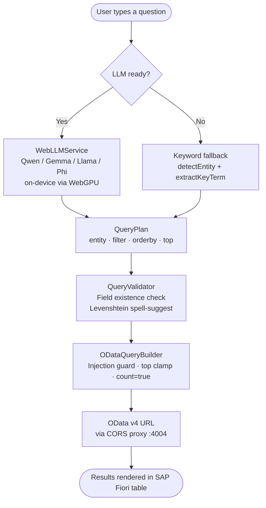

<div align="center">

# Floria — NL2OData Explorer

**Small Language Models for NL2OData: A No-Fine-Tuning Approach Validated on SAP Fiori**

*Prasanthkumar Yernagula · Independent Researcher*

[](https://github.com/Prashanthkumarpk/floria)
[](https://www.w3.org/TR/webgpu/)
[](https://openui5.org)
[](https://www.typescriptlang.org)
[](#models-tested)
[](#benchmark-results)
[](#benchmark-results)

</div>

---

Floria is a browser-based SAP Fiori application that translates plain-English questions into OData v4 queries using small language models that run **entirely on-device** via WebGPU. No query text ever reaches a remote inference server.

Five models from four providers — 0.5B to 3.8B parameters, **none fine-tuned on OData** — were evaluated against a 100-item benchmark under two metrics: the **Effective Success Rate (ESR)** and a stricter **exact match (EM)** against hand-written gold queries. Over up to three repeated runs the five on-device models averaged **87.8% ESR** and **89.3% EM**. A cloud model (Claude Haiku 5.5 via AWS Bedrock) run through the *same* prompt, post-processor and validator reached **95.0% ESR / 99.3% EM**, which bounds how much of the remaining gap is model capacity rather than pipeline design.

---

## Why This Exists

SAP chose OData as the standard data-access layer for Fiori applications. Business users who need ad-hoc reports must wait for developers to write those queries. A natural-language interface removes that bottleneck — but routing queries through a cloud LLM is often prohibited:

- Many markets SAP serves enforce **data-governance restrictions** that prohibit cloud proxies
- **HIPAA-compliant environments** explicitly forbid this pattern
- On-premises SAP systems may have **no internet egress** at all

WebGPU provides a viable alternative. It is a W3C-standardised API that lets browsers run transformer models natively on the user's GPU via Apache TVM compute shaders. WebLLM achieves throughput comparable to server-side inference on the same hardware.

The research question this project answers:

> *Can a sub-4B parameter model translate natural-language questions into valid OData v4 queries — using only schema injection at the prompt level, with no gradient updates — at accuracy levels useful in practice?*

---

## Five-Stage Pipeline



The **LLM path** is used when Qwen / Gemma / Llama / Phi has finished loading. The **direct path** runs keyword scoring immediately, so the application is fully functional even before the model is cached. (The keyword path is *not* a meaningful baseline: it handles a single search term only and fails T2 and T5 by construction.)

---

## Schema Injection Prompt — Four-Block Design

All models — on-device and cloud — use the **same** system prompt (`PROMPT_VERSION = "2026-10-17"`, recorded in every run file). No model was fine-tuned.

```
┌──────────────────────────────────────────────────────────────────┐
│                      SYSTEM PROMPT                               │
│                                                                  │
│  ┌──────────────┐  ┌──────────────┐  ┌──────────────┐  ┌──────┐ │
│  │  [ENTITIES]  │  │  [FORMAT]    │  │   [RULES]    │  │[EX-  │ │
│  │              │  │              │  │              │  │AMPLES│ │
│  │ Field names  │  │ JSON output  │  │ OData v4     │  │      │ │
│  │ and types    │  │ shape:       │  │ filter       │  │ few- │ │
│  │ for all 7    │  │ entity,      │  │ grammar with │  │ shot │ │
│  │ Northwind    │  │ filter,      │  │ WRONG/RIGHT  │  │demos │ │
│  │ entities     │  │ orderby, top │  │ pairs        │  │      │ │
│  └──────────────┘  └──────────────┘  └──────────────┘  └──────┘ │
└──────────────────────────────────────────────────────────────────┘
```

**Temperature is fixed at 0.1** across all models for maximum determinism.

> **Note on structured output:** `response_format:{type:"json_object"}` is intentionally omitted. In WebLLM v0.2.84 this flag crashes the TVM grammar compiler. The JSON structure is enforced through the prompt instruction instead — after generation, markdown fences are stripped and the first complete `{...}` block is extracted and parsed.

---

## Post-Processor — Six-Category Error Correction

Small models trained predominantly on OData v2 data produce predictable and **correctable** errors. Rather than trying to prompt away every edge case, a deterministic post-processor intercepts the model's raw output and repairs the six known failure modes before validation runs.

---

### Category 1 — OData v2 Containment Syntax

The `substringof` function is valid in OData v2 but does not exist in OData v4. Models that have seen more v2 than v4 training data default to it.

```
WRONG  substringof('chai', ProductName) eq true      ← OData v2
WRONG  substringof(ProductName, 'chai') eq true      ← reversed argument order, still v2

RIGHT  contains(ProductName,'chai')                  ← OData v4
```

The post-processor detects both argument orders and rewrites to `contains`.

---

### Category 2 — Flattened Disjunction

When asked for two values, models sometimes collapse both into a single quoted string instead of generating a proper OR expression.

```
WRONG  Country eq 'Germany or France'
                          ↑
               two values fused into one literal

RIGHT  Country eq 'Germany' or Country eq 'France'
```

The post-processor detects the pattern, splits the fused string on ` or `, and rebuilds the full OR predicate.

---

### Category 3 — Entity Name Aliasing

Models hallucinate entity names that look plausible but do not match the Northwind schema.

| Model output | Corrected to |
|---|---|
| `Catalog/Products` | `Products` |
| `OrderDetails` | `Order_Details` |
| `Order Details` | `Order_Details` |

---

### Category 4 — Field Name Aliasing

The same field concept exists under different names on different entities. Models sometimes use the generic form on an entity where a specific name is required.

```
WRONG  Country eq 'France'           ← on the Orders entity
RIGHT  ShipCountry eq 'France'       ← correct field on Orders

WRONG  ShipCountry eq 'Germany'      ← on the Customers entity
RIGHT  Country eq 'Germany'          ← correct field on Customers
```

---

### Category 5 — String Case Correction

Every string field in Northwind is title-cased. A case-insensitive containment check like `startswith(LastName,'d')` returns zero records even when matching rows exist.

```
WRONG  startswith(LastName,'d')     ← returns nothing
RIGHT  startswith(LastName,'D')     ← matches 'Davolio', 'Dodsworth', etc.
```

The post-processor title-cases the search term for `startswith` and `contains` predicates.

---

### Category 6 — Navigation Prefix Stripping

Models sometimes emit dot-notation field references copied from related schemas.

```
WRONG  Orders.ShipCountry eq 'France'
RIGHT  ShipCountry eq 'France'
```

---

> The prompt and post-processor are **identical across all models**. Switching models requires only specifying a different WebLLM model ID — no prompt tuning per model.

---

## Schema Validator

`QueryValidator` runs after the post-processor and before URL construction. It tokenises the `$filter` expression **after stripping all quoted string literals** — an earlier version that tokenised first was generating false-positive "field not found" errors for values like `ShipCountry eq 'France'` (incorrectly flagging `France` as a field name).

For any unrecognised field it computes Levenshtein distance against every known field on that entity and surfaces the closest match within edit distance 3:

```
⚠  Field 'OrderYear' does not exist on Orders — did you mean 'OrderDate'?
```

Validation is **advisory**: the request proceeds regardless so the OData server's own error is also surfaced. Only two conditions cause a hard reject before the URL is even built:

| Condition | Why |
|---|---|
| SQL injection sequences (`;` `--` `/*` `<script`) | Defence-in-depth for OData gateways that parse filter strings |
| Sort direction other than `asc` / `desc` | Prevents malformed URLs that some gateways mishandle |

---

## Models Tested

### On-device (the subject of the paper)

| Model | Provider | Parameters | Quantisation | Download size | Runs |
|---|---|---|---|---|---|
| Qwen2.5-0.5B-Instruct | Alibaba | 0.5 B | Q4F16 | ≈ 300 MB | 3 |
| Qwen2.5-Coder-1.5B-Instruct | Alibaba | 1.5 B | Q4F16 | ≈ 900 MB | 3 |
| Gemma-2-2B-it | Google | 2 B | Q4F16 | ≈ 1.5 GB | 1 † |
| Llama-3.2-3B-Instruct | Meta | 3 B | Q4F16 | ≈ 2.0 GB | 3 |
| Phi-3.5-mini-instruct | Microsoft | 3.8 B | Q4F16 | ≈ 2.2 GB | 1 † |

† Single run — the thermal and memory strain of running 1.5–2.2 GB models on a fanless laptop made repeated runs impractical.

### Cloud baseline (upper bound, not deployable under the constraints above)

| Model | Route | Runs |
|---|---|---|
| Claude Haiku 5.5 | AWS Bedrock via the local proxy (`/llm/bedrock`) — same prompt, post-processor, validator and scorer | 3 |

### Hardware

All on-device runs: **one MacBook Air (Apple M5, 8 cores, integrated GPU), Safari 26.6**. WebGPU exposes no utilisation counters, so latency and weight footprint are reported instead. The WebGPU `maxBufferSize` of 2 GiB is the hard ceiling on model size.

Weights are downloaded from HuggingFace on first launch, compiled to WebGPU shaders via Apache TVM, and cached in IndexedDB. Every subsequent launch uses the cache — cold-start after first download is under 4 seconds.

---

## Benchmark Results

**100-item benchmark · 20 queries per structural type · Northwind OData v4 · runs of 2026-10-17 / 2026-10-18**

### Query Taxonomy

| Type | Structure | Example query |
|---|---|---|
| **T1** | Entity read — no filter | *"list all suppliers"* |
| **T2** | Numeric range comparison | *"products under $15"* |
| **T3** | String match (`contains` / `startswith`) | *"products with chai in the name"* |
| **T4** | Categorical equality | *"customers from Germany"* |
| **T5** | Multi-value disjunction | *"customers from Germany or France"* |

### Metrics

| Metric | Definition |
|---|---|
| **ESR** — Effective Success Rate | Correct entity **and** the query returns ≥ 1 record. Cheap to compute, but it passes a wrong filter that happens to return rows. |
| **EM** — Exact Match | Correct entity **and** the generated `$filter`, after normalisation, equals the hand-written gold filter (or one of its accepted alternatives). `$top` / `$orderby` are logged but do not affect EM. |
| **FP** — ESR false-positive rate | Share of ESR passes that fail EM = `(ESR pass ∧ EM fail) / ESR passes`. |

Normalisation: lowercase, unify quotes, collapse whitespace, strip redundant parentheses, canonicalise numerals (`15.0` → `15`), and sort operands when a level uses a single connector (`A or B` ≡ `B or A`). Gold file: `BENCHMARK/gold/gold_queries.json` — 100 entries; 17 are flagged `review` (ambiguous natural-language readings), 5 of which carry `alt` lists of accepted equivalent filters.

Multi-run models are reported as **mean ± sample standard deviation** (n − 1 denominator).

### Table I — Exact Match per Type, Overall ESR / EM, and FP Rate (%)

| Model | T1 | T2 | T3 | T4 | T5 | **ESR** | **EM** | **FP** |
|---|:---:|:---:|:---:|:---:|:---:|:---:|:---:|:---:|
| Qwen-0.5B | 91.7 | 90.0 | 48.3 | 86.7 | 95.0 | 80.3 ± 0.6 | 82.3 ± 0.6 | 8.3 ± 0.7 |
| Qwen-Coder-1.5B | 90.0 | 96.7 | 95.0 | 100 | 100 | 93.7 ± 0.6 | **96.3 ± 0.6** | 1.4 ± 1.2 |
| Gemma-2B † | 95.0 | 90.0 | 80.0 | 85.0 | 95.0 | 86.0 | 89.0 | 1.2 |
| Llama-3B | 95.0 | 95.0 | 78.3 | 90.0 | 100 | 89.0 ± 0.0 | 91.7 ± 0.6 | 1.5 ± 0.6 |
| Phi-3.5B † | 90.0 | 95.0 | 85.0 | 90.0 | 75.0 | 90.0 | 87.0 | 5.6 |
| Haiku-5.5 (cloud) | 100 | 100 | 96.7 | 100 | 100 | 95.0 ± 0.0 | 99.3 ± 0.6 | 0.0 ± 0.0 |

T1–T5 columns are EM. **Mean of the five on-device models: ESR 87.8%, EM 89.3%.**

```
ESR mean = (80.3 + 93.7 + 86.0 + 89.0 + 90.0) / 5 = 439.0 / 5 = 87.8
EM  mean = (82.3 + 96.3 + 89.0 + 91.7 + 87.0) / 5 = 446.3 / 5 = 89.3
```

### ESR per Type (same runs)

| Model | T1 | T2 | T3 | T4 | T5 | **ESR** |
|---|:---:|:---:|:---:|:---:|:---:|:---:|
| Qwen-0.5B | 81.7 | 90.0 | 48.3 | 91.7 | 90.0 | 80.3 |
| Qwen-Coder-1.5B | 93.3 | 100 | 80.0 | 100 | 95.0 | 93.7 |
| Gemma-2B † | 95.0 | 90.0 | 65.0 | 90.0 | 90.0 | 86.0 |
| Llama-3B | 95.0 | 95.0 | 65.0 | 95.0 | 95.0 | 89.0 |
| Phi-3.5B † | 90.0 | 100 | 80.0 | 100 | 80.0 | 90.0 |
| Haiku-5.5 (cloud) | 100 | 100 | 80.0 | 100 | 95.0 | 95.0 |

### ESR vs EM by Model

```mermaid
xychart-beta
    title "ESR vs Exact Match — 100-query benchmark (mean of available runs)"
    x-axis ["Qwen-0.5B", "Qwen-Coder-1.5B", "Gemma-2B", "Llama-3B", "Phi-3.5B", "Haiku-5.5 (cloud)"]
    y-axis "Accuracy %" 70 --> 100
    bar [80.3, 93.7, 86.0, 89.0, 90.0, 95.0]
    bar [82.3, 96.3, 89.0, 91.7, 87.0, 99.3]
```



First series = ESR, second = EM.

### Per-Run Detail (raw counts out of 100)

| Model | Run | ESR | EM | Pass both | ESR only (= FP) | EM only | FP rate | Median ms |
|---|:---:|:---:|:---:|:---:|:---:|:---:|:---:|:---:|
| Qwen-0.5B | 1 | 81 | 82 | 74 | 7 | 8 | 7/81 = 8.6% | 2 066 |
| Qwen-0.5B | 2 | 80 | 83 | 74 | 6 | 9 | 6/80 = 7.5% | 2 104 |
| Qwen-0.5B | 3 | 80 | 82 | 73 | 7 | 9 | 7/80 = 8.8% | 2 076 |
| Qwen-Coder-1.5B | 1 | 94 | 96 | 92 | 2 | 4 | 2/94 = 2.1% | 6 796 |
| Qwen-Coder-1.5B | 2 | 94 | 96 | 92 | 2 | 4 | 2/94 = 2.1% | 7 256 |
| Qwen-Coder-1.5B | 3 | 93 | 97 | 93 | 0 | 4 | 0/93 = 0.0% | 7 602 |
| Gemma-2B | 1 | 86 | 89 | 85 | 1 | 4 | 1/86 = 1.2% | 11 702 |
| Llama-3B | 1 | 89 | 92 | 88 | 1 | 4 | 1/89 = 1.1% | 12 271 |
| Llama-3B | 2 | 89 | 92 | 88 | 1 | 4 | 1/89 = 1.1% | 12 255 |
| Llama-3B | 3 | 89 | 91 | 87 | 2 | 4 | 2/89 = 2.2% | 12 664 |
| Phi-3.5B | 1 | 90 | 87 | 85 | 5 | 2 | 5/90 = 5.6% | 20 582 |
| Haiku-5.5 (cloud) | 1 | 95 | 99 | 95 | 0 | 4 | 0/95 = 0.0% | 1 303 |
| Haiku-5.5 (cloud) | 2 | 95 | 100 | 95 | 0 | 5 | 0/95 = 0.0% | 1 295 |
| Haiku-5.5 (cloud) | 3 | 95 | 99 | 95 | 0 | 4 | 0/95 = 0.0% | 1 306 |

#### Worked example — how the Qwen-0.5B row is computed

```
ESR per run        : 81, 80, 80
  mean             = 241 / 3                         = 80.33  →  80.3
  sample SD        = √[((0.67)² + (0.33)² + (0.33)²) / 2]
                   = √(0.667 / 2) = √0.333           = 0.58   →  0.6

EM per run         : 82, 83, 82
  mean             = 247 / 3                         = 82.33  →  82.3
  sample SD        = √(0.667 / 2)                    = 0.58   →  0.6

FP rate per run    : 7/81 = 8.64,  6/80 = 7.50,  7/80 = 8.75
  mean             = 24.89 / 3                       = 8.30   →  8.3
  sample SD        = √[((0.34)² + (0.80)² + (0.45)²) / 2]
                   = √(0.98 / 2) = √0.49             = 0.70   →  0.7

T3 EM per run      : 9/20, 10/20, 10/20  =  45, 50, 50
  mean             = 145 / 3                         = 48.33  →  48.3
```

#### Why EM can exceed ESR

Queries that **pass EM but fail ESR** have a filter identical to the gold yet return zero rows:

| # | Type | Query | Why zero rows | Models affected |
|---|---|---|---|---|
| 56 | T3 | products containing pasta | No such product in Northwind | all six |
| 58 | T3 | products with anchov in the name | No such product in Northwind | all except Phi |
| 59 | T3 | products with caviar in the name | No such product in Northwind | all six |
| 97 | T5 | customers from Australia or New Zealand | No such customers in Northwind | all except Phi |
| 49 | T3 | employees with name starting with A | Gold `startswith(LastName,'A')` — no Northwind employee matches | Haiku only |
| 17, 18, 57, 71, 93 | T1/T3/T4/T5 | *(Qwen-0.5B only)* | Correct `$filter`, but an `$orderby` on a non-existent field (e.g. `CategoryName` on Products) made the server return 0 rows. EM ignores `$orderby` by design. | Qwen-0.5B |

### Run-to-Run Variance (temperature 0.1)

- Overall ESR / EM moved by **at most 1 query** (1 point) between runs of the same model.
- Per-category scores moved by **at most 5 points** (= one query out of twenty), e.g. Qwen-0.5B T1 EM 95 / 90 / 90, Llama-3B T3 EM 80 / 80 / 75, Haiku T3 EM 95 / 100 / 95.

### Table II — Per-Query Latency and Weight Footprint

Latency = question → parsed plan, measured in the browser. **Median** is reported because WebGPU shader compilation makes a few queries exceptionally slow (max column); no query exceeded 100 s in any run.

| Model | Weights | Median ms (mean ± SD over runs) | Max ms |
|---|---:|---:|---:|
| Qwen-0.5B | 300 MB | 2 082 ± 20 | 9 826 |
| Qwen-Coder-1.5B | 900 MB | 7 218 ± 404 | 9 212 |
| Gemma-2B † | 1.5 GB | 11 702 | 14 406 |
| Llama-3B | 2.0 GB | 12 397 ± 232 | 15 922 |
| Phi-3.5B † | 2.2 GB | 20 582 | 30 123 |
| Haiku-5.5 (cloud) | — | 1 301 ± 6 | 6 138 |

These numbers come from one browser on one computer; they show the **relative** cost of each model, not absolute performance across client hardware.

### Failure Patterns (from `BENCHMARK/exact_match/mismatches.json`)

EM misses per model, summed over all runs: Qwen-0.5B 53 · Llama-3B 25 · Phi-3.5B 13 · Gemma-2B 11 · Qwen-Coder-1.5B 11 · Haiku-5.5 2.

- **Qwen-0.5B — `contains` vs `startswith` confusion.** *"suppliers starting with exotic"* → `contains(CompanyName,'exotic')`. Returns the same rows in Northwind, so it passes ESR but fails EM — this is most of its 8.3% FP rate. It also emits malformed clauses (`contains(ProductName,' sauce')`), fabricated field names, and invalid `$orderby` fields.
- **Phi-3.5-mini — extra conditions and broken OR quoting.** Adds predicates not in the question (`Country eq 'USA'` for a Seattle query) and drops quotes in disjunctions (`Country eq 'Argentina or Country eq 'Mexico'`). The post-processor does not yet catch the second pattern; a check for it would recover most of Phi's T5 loss (75%).
- **Both Qwen models** occasionally omit the `Discontinued` filter — caught by EM, invisible to ESR.
- **All models, including the cloud one,** produce entirely invalid JSON on a few queries, failing both metrics.

### Key Observations

- **Qwen-Coder-1.5B is the best on-device model** — highest ESR (93.7) and EM (96.3) of the five, at ≈ 7 s per query and 900 MB. Code-specialised pretraining beats raw parameter count.
- **Qwen-0.5B is the only option for memory-constrained devices** (300 MB, ≈ 2 s per query), but its T3 EM is 48.3% and its FP rate 8.3% — use with caution for string-search queries.
- **Models above 1.5 GB were slower than both Qwen variants and no more accurate.**
- **T3 (string match) is the hardest category** for every model including the cloud baseline (ESR 80 on T3, because of the data-limited queries above). **T5 (disjunction)**, expected to be hardest, scored ≈ 100% EM for all local models except Phi-3.5-mini.
- **The cloud baseline isolates model capacity:** same pipeline, 99.3% EM vs 96.3% for the best on-device model — a 3-point gap.

---

## Benchmark Artifacts & Reproducibility

Everything behind the tables above is in the repository:

| Path | Contents |
|---|---|
| `BENCHMARK/gold/gold_queries.json` | 100 gold OData filters aligned to `BENCHMARK_QUERIES` in the controller; `alt` = accepted equivalents |
| `BENCHMARK/runs/*.json` | One raw run file per model (3 repetitions where available): every generated plan, pre-post-processor plan, raw LLM text, OData URL, HTTP status, record count, timing, hardware and `promptVersion` |
| `BENCHMARK/Archive/*.csv` | Excel-friendly exports of the same runs (per-query rows + summary block), plus the original Sep-30 ESR-only runs |
| `BENCHMARK/exact_match/summary.json` / `summary.md` | Scorer output: all tables above, including ready-to-paste LaTeX rows |
| `BENCHMARK/exact_match/mismatches.json` | Every EM miss with gold vs generated filter, normalised forms, URL and raw model text |

```bash
npm run check-gold     # gold ↔ controller alignment, all field names valid
npm run check-parity   # in-app normaliser == offline normaliser
npm run score          # recompute ESR / EM / FP / latency from BENCHMARK/runs/*.json
node scripts/score-exact-match.mjs --self-test   # normaliser equivalence tests
```

To regenerate a run: Research Dashboard → pick a model → set **×3** → run the 100-query suite → click **JSON** (and **Download** for CSV) → save into `BENCHMARK/runs/` → `npm run score`. See `BENCHMARK/README.md` for details.

---

## OData Service — Northwind v4

The benchmark and live application run against the **Northwind OData v4** public service, the canonical SAP/Microsoft reference dataset for OData demonstrations.

```
https://services.odata.org/V4/Northwind/Northwind.svc/
```

Seven entity sets are exposed, covering the full range of query structures in the benchmark:

| Entity | Key filterable fields |
|---|---|
| `Products` | `ProductName`, `UnitPrice`, `UnitsInStock`, `Discontinued`, `CategoryID` |
| `Categories` | `CategoryName` |
| `Customers` | `CompanyName`, `Country`, `City` |
| `Orders` | `ShipCountry`, `ShipCity`, `Freight`, `OrderDate` |
| `Employees` | `FirstName`, `LastName`, `Country`, `City` |
| `Suppliers` | `CompanyName`, `Country`, `City` |
| `Order_Details` | `OrderID`, `ProductID`, `Quantity`, `Discount` |

**Why a local proxy is required.** Browsers enforce the Same-Origin Policy: a script served from `localhost:8081` cannot fetch from `services.odata.org` unless that server sends `Access-Control-Allow-Origin` headers — which Northwind does not. The Express proxy at `srv/server.mjs` (port 4004) forwards every request from `/odata/` to the Northwind service and injects the required CORS headers on the way back. The same proxy serves the gold file (`/gold/`) and, when `AWS_BEARER_TOKEN_BEDROCK` is set in `.env`, the cloud-baseline route (`/llm/bedrock`) — the browser never sees the key.

```
Browser (localhost:8081)
        │  fetch /odata/Products?$filter=...
        ▼
Proxy (localhost:4004)               ← adds Access-Control-Allow-Origin
        │  forwards to
        ▼
services.odata.org/V4/Northwind/Northwind.svc/Products?$filter=...
```

All string field values in Northwind are **title-cased** (`'Germany'`, not `'germany'`). This is one of the six post-processor correction categories — models that lowercase their string literals produce queries that match nothing.

---

## Technology Stack

| Layer | Technology | Why |
|---|---|---|
| UI framework | OpenUI5 1.130.2 | SAP standard; Fiori design system, rich data binding |
| Language | TypeScript | Type safety on OData field names; catches schema mismatches at compile time |
| AI inference | WebLLM / MLC-LLM (`@mlc-ai/web-llm` 0.2.84) | Runs LLM in browser via WebGPU — no server, no API key |
| Cloud baseline | AWS Bedrock (Claude Haiku 5.5) via proxy | Upper-bound reference with identical pipeline; optional |
| OData target | Northwind v4 (`services.odata.org`) | Public, stable, well-known for SAP demos |
| Proxy | Express.js (`srv/server.mjs`, port 4004) | CORS headers, gold file, Bedrock route |
| Scoring | Node ESM scripts (`scripts/`) | Offline, reproducible ESR / EM / FP computation |
| Build / dev | `@sap/ui5-tooling`, `fiori run` (port 8081) | Standard SAP Fiori toolchain |

---

## Getting Started

**Requirements:** Node.js LTS · a WebGPU-capable browser (Chrome 113+, Edge 113+, Safari 26+; Firefox not supported)

```bash
# 1. Install dependencies (also fetches the WebLLM bundle into webapp/libs)
npm install

# 2. Start proxy + Fiori dev server together
npm start
# Proxy: http://localhost:4004   UI: http://localhost:8081/index.html

# Optional — cloud baseline
cp .env.example .env         # then set AWS_BEARER_TOKEN_BEDROCK=... (.env is gitignored; never commit it)
```

**First launch:** The model (~300 MB for Qwen-0.5B, up to ~2.2 GB for Phi-3.5B) is downloaded from HuggingFace and compiled to WebGPU shaders. A progress bar tracks the download. All subsequent launches read from the IndexedDB cache. **Pre-cache All** downloads every model once (~7 GB) for instant switching.

**Switch models** from the model selector — each entry maps to a WebLLM checkpoint ID (or the Bedrock route for the cloud baseline).

**Type-check without building:**
```bash
npx tsc --noEmit
```

---

## Project Structure

```
floria/
├── webapp/
│   ├── controller/
│   │   └── Chat.controller.ts      Pipeline orchestration · 100-query benchmark runner · CSV/JSON export · live EM
│   ├── util/
│   │   ├── WebLLMService.ts        LLM lifecycle · model registry · four-block prompt · post-processor · PROMPT_VERSION
│   │   ├── QueryValidator.ts       Field validation · Levenshtein spell-suggest
│   │   └── ODataQueryBuilder.ts    QueryPlan → OData v4 URL · injection guard
│   ├── view/
│   │   └── Chat.view.xml           SAP ObjectPageLayout — query · results · research dashboard
│   └── libs/web-llm/loader.js      ESM bridge: loads WebLLM into window.mlc
├── srv/
│   └── server.mjs                  Express proxy: /odata (CORS) · /gold · /llm/bedrock
├── scripts/
│   ├── score-exact-match.mjs       Offline ESR / EM / FP / latency scorer
│   ├── check-gold.mjs              Gold ↔ controller alignment check
│   ├── check-normalizer-parity.mjs In-app vs offline normaliser parity
│   └── lib/                        normalize.mjs · gold.mjs
├── BENCHMARK/
│   ├── gold/                       gold_queries.json
│   ├── runs/                       Raw per-model run files (JSON)
│   ├── Archive/                    CSV exports
│   ├── exact_match/                summary.json · summary.md · mismatches.json
│   └── README.md                   Reproduction guide
├── CLAUDE.md                       Full architecture reference
└── README.md                       This file
```

---

## Research Dashboard

The application ships with a live implementation of the paper's evaluation framework — no separate tooling required.

| Feature | What it shows |
|---|---|
| **Session statistics strip** | Total Queries · AI Mode · Direct Mode · Validator Catches · Server Errors · ESR % |
| **Query type classifier** | Assigns T1–T5 label to every query in real time using `classifyQueryType` |
| **Query history panel** | Timestamped entries with entity, type, validation state, timing, confidence, and success |
| **Benchmark runner** | Runs the 100-query suite (plus custom queries) ×N times; shows expected vs generated query, ESR and EM per row, timing; exports CSV (with summary block) and JSON (for `npm run score`) |
| **Pre-cache All** | Downloads every registered model once for instant switching |

---

## Known Limitations

**T3 string-match accuracy is the performance ceiling** for all sub-4B models without fine-tuning (48.3–95.0% EM). The post-processor's `substringof` → `contains` rewrite closes part of the gap but cannot fix `contains`/`startswith` confusion or fabricated field names.

**EM is exact match after normalisation, not semantic equivalence.** `contains(CompanyName,'exotic')` and `startswith(CompanyName,'exotic')` return the same Northwind rows but only one matches gold. Executing both queries and comparing result sets is the natural next step.

**ESR has two known gaps** — a subset-returning filter passes, and a wrong entity that still returns rows passes. EM now quantifies this: 1.2–8.3% of ESR passes on-device, 0% for the cloud baseline.

**No `$expand` / `$apply` / nested filters.** Navigation-property expansion and aggregation are outside the benchmark taxonomy and the current prompt. Adding them means navigation-property names in the ENTITIES block plus a post-processor category for path syntax (`$expand`) and a grammar block for `groupby` / `aggregate` (`$apply`).

**Single-device latency.** All timing data is from one MacBook Air M5 in Safari 26.6; treat Table II as relative cost, not absolute.

**WebGPU is required.** Firefox does not support WebGPU. Models above 1.5 GB are slower and gave no accuracy benefit on this hardware.

---

## Comparison with Fine-Tuned Approaches

The closest prior work is **OmniOData** (Bai et al., ACL 2026 Industry Track), which fine-tunes 1.5B and 3B Qwen2.5-Coder models in two stages (SFT then GRPO) on a synthetic corpus of 110K+ execution-verified queries. Their 3B model outperforms GPT-4o and Gemini-Pro on their internal benchmark.

| Dimension | Floria (this work) | OmniOData |
|---|---|---|
| Fine-tuning required | No | Yes (SFT + GRPO) |
| Training data needed | None | 110K+ synthetic queries |
| Runs in browser | Yes (WebGPU) | No (server-side) |
| Model size limit | ~2 GiB (WebGPU buffer / IndexedDB) | Unbounded |
| Data leaves the client | Never | Yes |
| Applicable under data regulations | Yes | Depends on deployment |

Floria is not a replacement for a fine-tuned system when training infrastructure is available. It is the viable alternative when it is not — and the cloud baseline shows that with the same pipeline, the remaining accuracy gap (≈ 3 EM points) is model capacity, not design.
